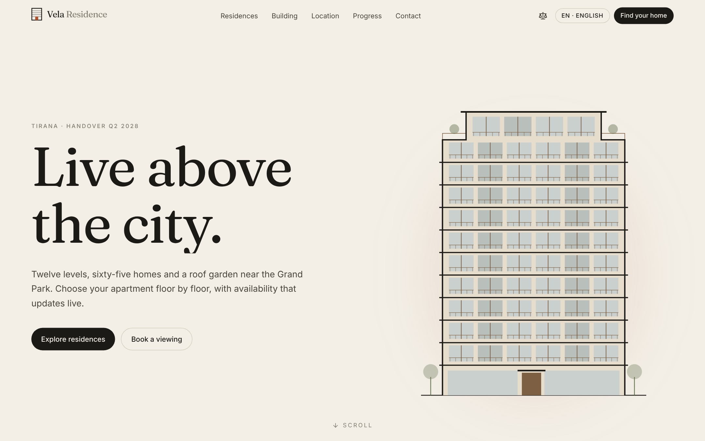
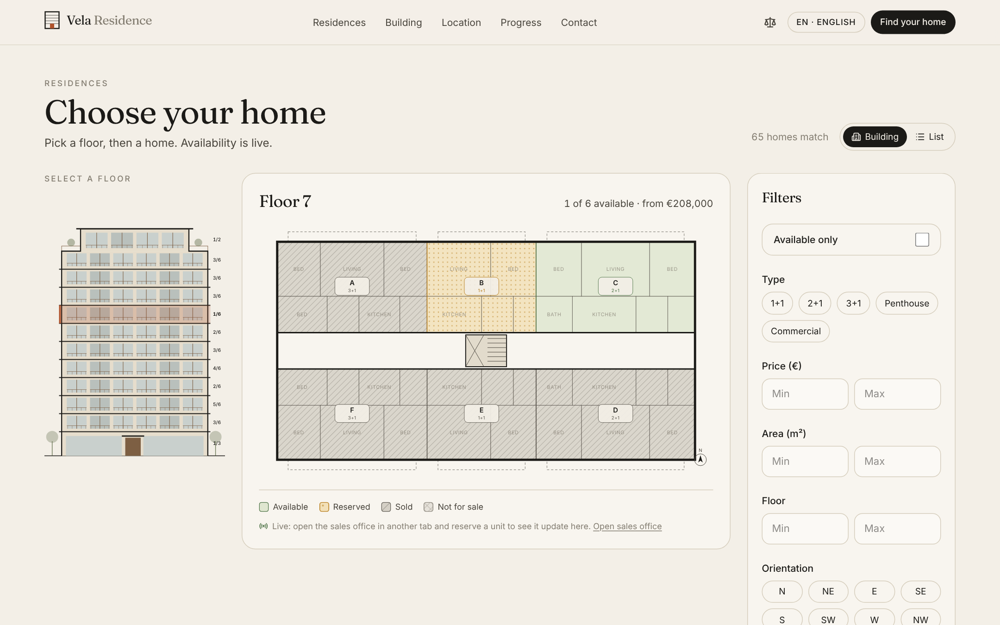
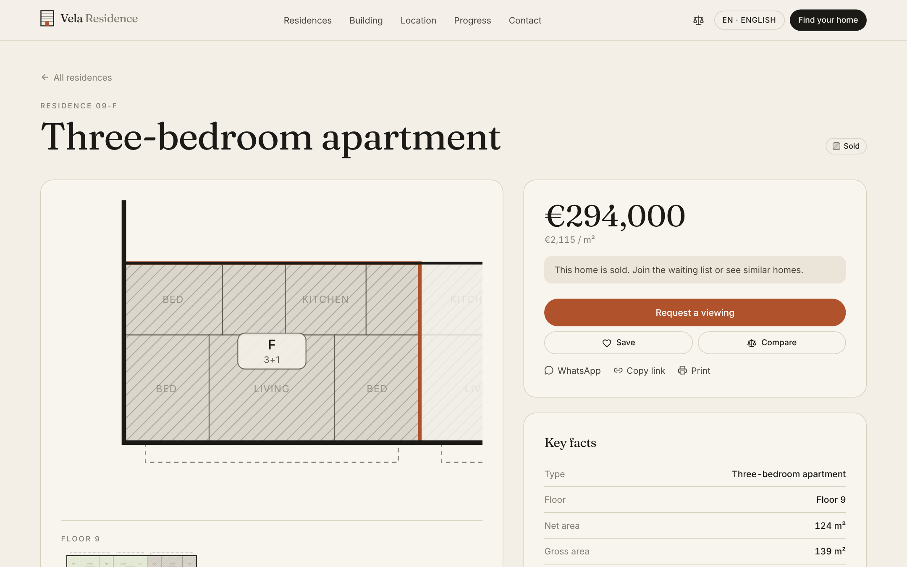
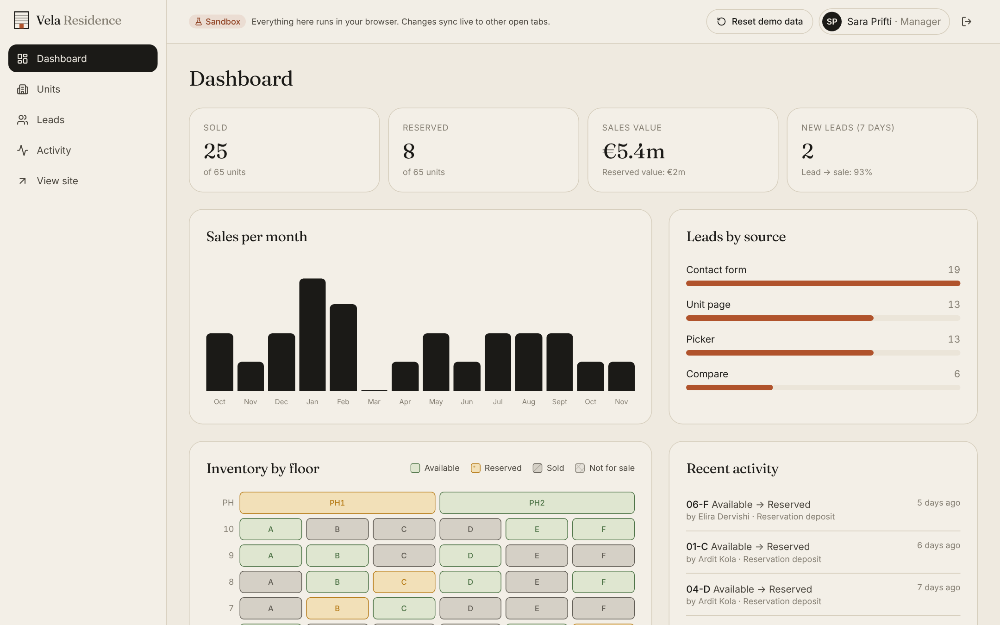
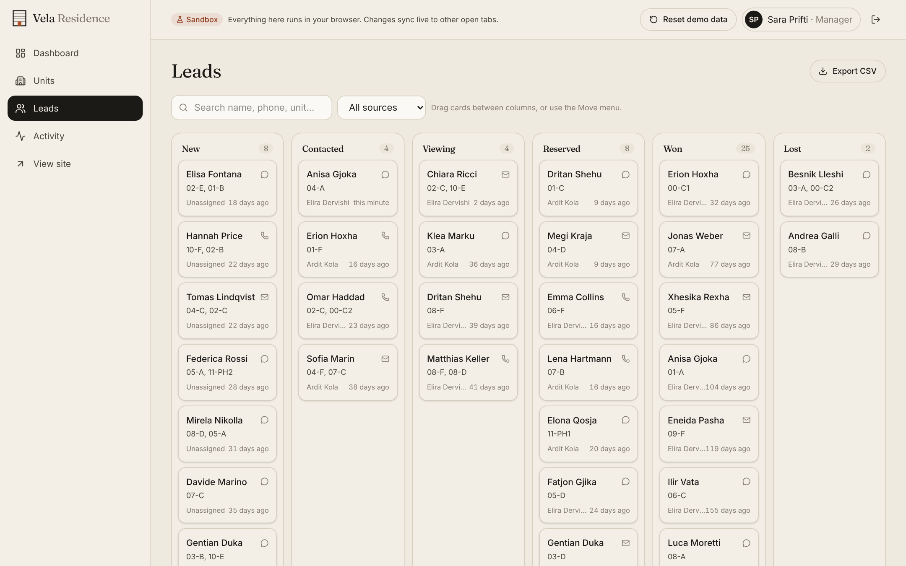
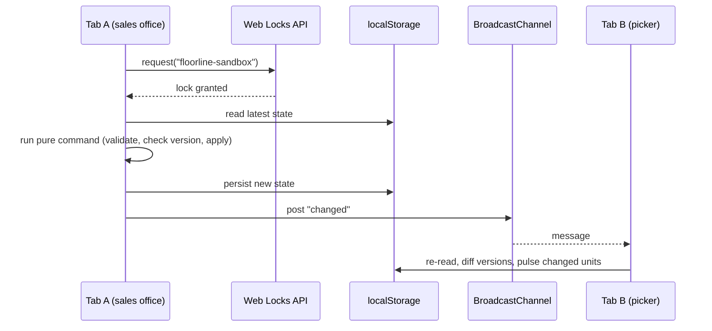

# Floorline

**A pre-sales platform for residential developments.** Buyers pick an apartment floor by floor on a live, clickable building. The sales team runs reservations, pricing and leads from a back office. Every status change shows up on the public site instantly.

The demo project is **Vela Residence**, a fictional 12-level building in Tirana with 65 units, in English, Albanian and Italian.

[](https://github.com/vortex378/floorline/actions/workflows/ci.yml)

**Live demo:** [vela-floorline.vercel.app](https://vela-floorline.vercel.app)
&nbsp;·&nbsp; Sales office: [/en/admin](https://vela-floorline.vercel.app/en/admin) (choose a demo persona, no password)



> Demo build: there is no database. A browser-side sandbox stands in for the backend (details below), so every visitor gets their own copy of the data and can't break anyone else's demo.

---

## What it does

**For buyers**

- **Building → floor → unit picker.** The elevation drawing works as a floor selector, and the generated architectural floor plans have clickable units. Status is shown with color *and* pattern, so it's readable without color vision.
- **Filters** for type (`1+1`, `2+1`, `3+1`, penthouse, commercial), price, area, floor, orientation and availability. They're stored in the URL, so a filtered view can be shared as a link.
- **Live availability.** Reserve a unit in the sales office in another tab and the picker updates in place, with a pulse on the changed unit.
- **Unit pages** (195, prerendered): a zoomed floor plan, key facts, a compass, €/m², similar homes, a WhatsApp share link, a print stylesheet and JSON-LD.
- **Favorites and compare** (up to 3 units side by side).
- **Viewing / reservation requests** validated with one Zod schema, plus a honeypot and per-visitor rate limiting.
- **i18n**: `en`, `sq`, `it`, with localized prices, dates, `hreflang` and a sitemap for every unit in every language.

**For the sales team** (`/admin`)

- **Dashboard:** units sold and reserved, sales value, lead→sale conversion, sales per month, leads by source, an inventory grid by floor and recent activity.
- **Units:** status changes go through a state machine, can be linked to a lead, and carry notes and full history. Managers can edit prices, hide prices and run a **bulk price change with a diff preview**.
- **Leads:** a kanban board (drag and drop or menu) with assignment, notes and **CSV export**.
- **Roles:** a *manager* can do everything. An *agent* can't change prices, can't undo a sale and can't see the price audit log. The permissions live in the domain layer, so they don't depend on hidden buttons.

| Picker | Unit page |
|---|---|
|  |  |

| Dashboard | Leads |
|---|---|
|  |  |

---

## Engineering notes

### Commands are pure, and the store runs them like transactions

All business rules live in `src/domain` as pure functions, `(state, input, ctx) → Result`:
`changeUnitStatus`, `setUnitPrice`, `bulkAdjustPrices`, `submitLead`, `moveLead`, and so on. They hold no React and no I/O, and they're fully unit-tested.

The browser store (`src/lib/store/sandbox.ts`) runs each command like a small transaction:



- **The cross-tab mutex** comes from `navigator.locks`. A command always re-reads the latest persisted state inside the lock, so two tabs can't overwrite each other's writes.
- **Optimistic concurrency:** every unit has a `version`, and a status or price change sends the version the user saw. If another agent changed the unit in the meantime, the command fails with `conflict` and the UI shows the latest data. A test covers this: *two agents reserve the same unit, exactly one wins*.
- **Realtime:** other tabs receive changes through `BroadcastChannel` (with the `storage` event as a fallback) and pulse only the units whose version changed.
- **Hydration-safe:** the seed is deterministic (a seeded PRNG), so the 213 prerendered pages and the first client render always agree. `useSyncExternalStore` then swaps in the visitor's sandbox.

Moving to a real backend means swapping `dispatch` for a server action or RPC that runs the same command inside a database transaction. The domain layer doesn't change.

### Floor plans are data

Every floor plan is generated from polygons in `src/domain/layouts.ts`. The same polygons draw the walls and rooms and act as the click targets, so the drawing and the hit areas can't drift apart. No image assets are needed.

### Motion without hurting performance

GSAP + ScrollTrigger and Lenis share one clock (`gsap.ticker`). There's a split-text hero, a facade that draws itself, a pinned horizontal typology gallery and floor-by-floor reveals. Only `transform` and `opacity` are animated. With `prefers-reduced-motion`, Lenis and the scroll-scrubbed effects turn off.

### Accessibility

- Floors and units are real buttons: <kbd>Tab</kbd> / <kbd>↑</kbd> <kbd>↓</kbd> / <kbd>Enter</kbd> / <kbd>Esc</kbd>.
- Each unit has a full label (*"07-B, 1+1, 61 m², Reserved"*).
- Dialogs use Radix (focus trap, Escape, ARIA).
- There's a skip link, and status is never shown by color alone.

---

## Tech stack

Next.js 16 (App Router, Cache Components, `proxy.ts` locale routing) · React 19 · TypeScript (strict) · Tailwind CSS 4 · GSAP + ScrollTrigger · Lenis · Radix Dialog · Zod · Vitest · Playwright · GitHub Actions · Vercel

## Tests

```bash
pnpm test        # 32 unit tests: domain rules, pricing, concurrency, filters ↔ URL, i18n key parity, CSV
pnpm test:e2e    # Playwright, desktop + mobile
```

The end-to-end tests cover:

- filter → unit → request a viewing → the lead appears in the sales office
- **live update across tabs**
- **a stale edit is rejected** (optimistic locking)
- keyboard-only picker
- the locale switch keeps the current path
- agents can't bulk-price
- mobile filter sheet

CI runs lint, typecheck, unit tests, build and the e2e suite on every push.

## Run locally

```bash
pnpm install
pnpm dev          # http://localhost:3000 → redirects to /en
```

## Project structure

```
src/
  domain/          pure business logic: types, layouts, pricing, rules, commands, filters, seed
  lib/store/       browser sandbox: persistence, locks, cross-tab sync, React hooks
  lib/i18n/        dictionaries (en / sq / it), translator, formatters
  components/      building (facade, floor plan), picker, unit, home, admin, motion, ui
  app/[lang]/      routes: home, units, units/[code], compare, admin/*
tests/unit         Vitest
tests/e2e          Playwright
```

---

Vela Residence is fictional: no real building, developer, people or prices. Built by [Arkel Lahi](https://github.com/vortex378). MIT licensed.
